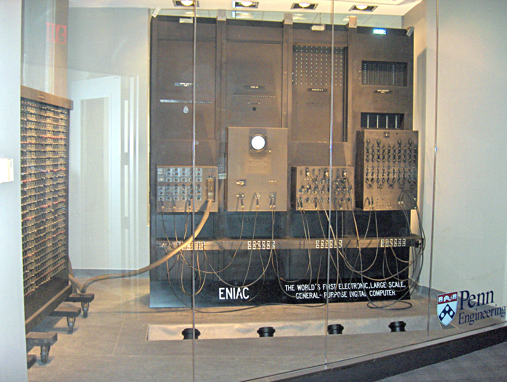

🔢 Why Do We Use the Decimal Number System?
-------------------------------------------

### 🧠 Human Adoption (Base-10)

The **Decimal Number System** is based on **Base-10** and is widely used because:

*   Humans naturally have **10 fingers**, making counting intuitive.
    
*   Early civilizations used fingers for **counting, trading, and measurements**.
    
*   The **place value system** (ones, tens, hundreds, thousands) made arithmetic simple and scalable.
    
*   It became standardized in **education, commerce, and daily life** across cultures.
    

### 💡 Historical Insight

Early computing engineers also found decimal intuitive.

*   Some early computers, such as **ENIAC**, internally used **decimal representation** instead of binary.
    
*   This shows that **decimal was a natural human choice**, even in early machine design.



🖥️ Why Do Computers Use Binary, Octal, and Hexadecimal?
--------------------------------------------------------

### 📌 Binary: The Foundation (Base-2)

Computers fundamentally work on **Binary (Base-2)** because:

*   Electronic components (transistors) have **two states only**:
    
    *   ON → 1
        
    *   OFF → 0
        
*   Binary is **reliable, fast, and easy to implement in hardware**.
    

⚠️ Problem:Binary numbers become **very long and difficult** for humans to read and debug.

🧮 Octal and Hexadecimal: Human-Friendly Representations
--------------------------------------------------------

To make binary easier to work with, **Octal** and **Hexadecimal** are used.

### 🔹 Octal Number System (Base-8)

*   Uses digits: 0–7
    
*   Based on powers of 2
    
*   **1 octal digit = 3 binary digits**
    

```yaml
   Binary: 101 110 011  Octal :  5   6   3   
```

### 🔹 Hexadecimal Number System (Base-16)

*   Uses digits: 0–9 and A–F
    
*   **1 hex digit = 4 binary digits**
    

```yaml
   Binary: 1101 1010  Hex   :   D    A   
```

✅ Why Octal & Hexadecimal Are Important

✔️ Shorter and more readable than binary

✔️ Easy conversion to and from binary

✔️ Widely used in:

Memory addresses

Machine code

Debugging

Low-level programming

## 📌 Summary Table

| Number System | Base | Used By      | Reason                         |
|--------------|------|--------------|--------------------------------|
| Decimal      | 10   | Humans       | Natural counting               |
| Binary       | 2    | Computers    | Hardware compatibility         |
| Octal        | 8    | Programmers  | Binary compression (3 bits)    |
| Hexadecimal  | 16   | Programmers  | Binary compression (4 bits)    |
